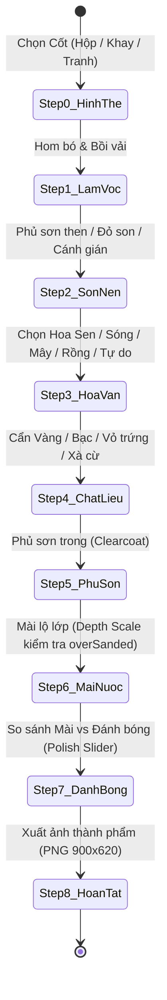

# Báo Cáo Kỹ Thuật Chuyên Sâu: Kiến Trúc Ứng Dụng, Đồ Họa WebGL & Động Cơ Mô Phỏng Sơn Mài

> **Tài liệu phân tích kỹ thuật giải mã ngược (Reverse-Engineering Technical Specification)**  
> **Dự án:** Sơn Son Mài Sắc (SSMS) · **Mã nguồn:** Next.js 14 / Three.js / Dual-Buffer Canvas 2D

---

## I. KIẾN TRÚC TỔNG THỂ HỆ THỐNG (SYSTEM ARCHITECTURE)

- **Framework cốt lõi:** Next.js 14+ App Router kết hợp kiến trúc React Server Components (RSC) và Client Hydration.
- **Môi trường vận hành:** Vercel Global Edge Network (Edge Runtime / Serverless Functions).
- **Phân tách mô-đun:**
  - *Server-side:* Đảm nhận pre-render toàn bộ 9 tuyến trang tĩnh, tối ưu hóa SEO meta, OpenGraph tags, và cung cấp endpoint `/api/news`.
  - *Client-side:* Đảm nhận 3 động cơ tương tác đồ họa chính:
    1. **Động cơ mô phỏng tạo tác sơn mài (Procedural Lacquer Engine - Canvas 2D Dual-Buffer)**
    2. **Bộ xoay 360 độ quang học (Interactive Photogrammetry Box Viewer)**
    3. **Trình khắc họa tiết mặt hộp đa chiều (Face Engraving Canvas Editor)**

---

## II. ĐỘNG CƠ ĐỒ HỌA MÔ PHỎNG SƠN MÀI (PROCEDURAL LACQUER ENGINE)

### 1. Kiến Trúc Dual-Buffer (2 Canvas Song Song 900x620)
Để tái hiện chân thực quá trình sơn mài (nơi các lớp vật liệu nằm ở các độ sâu khác nhau dưới lớp sơn then/sơn cánh gián và chỉ lộ ra khi mài nước), hệ thống sử dụng **2 Canvas 900x620 độc lập**:
1. **Color Buffer (Context 'a'):** Vẽ màu sắc, ánh kim, vân rạn vỏ trứng và độ phản quang quang học.
2. **Depthmap Buffer (Context 'r'):** Lưu trữ bản đồ độ sâu vật lý (Grayscale 0–255). Mỗi chất liệu khi đặt vào bố cục được gán một mức độ sâu:
   Grayscale Value = round((depth / 100) * 255)

### 2. Thuật Toán Tạo Hình Vector Độc Quyền (Bézier Procedural Geometry)
Động cơ hỗ trợ 5 chế độ họa tiết tạo hình hoàn toàn bằng giải thuật toán học:
- **Hoa Sen (12 Cánh Bézier):**
  - Sử dụng đường cong bậc 3 đối xứng qua trục:
    ```javascript
    a.moveTo(0, 14);
    a.bezierCurveTo(-53, -38, -47, -110, 0, -164);
    a.bezierCurveTo(47, -110, 53, -38, 0, 14);
    ```
  - Xoay đều 12 góc xung quanh nhụy hoa tròn `arc(0, 0, 23, 0, 2 * Math.PI)`.
- **Sóng Nước (7 Dải Thủy Ba):**
  - Chạy vòng lặp 7 dải (e = -3..3, khoảng cách 48px) với đường cong uốn lượn liên hoàn:
    ```javascript
    t.moveTo(-280, a);
    t.bezierCurveTo(-120, a - 54, 100, a + 45, 280, a - 10);
    ```
- **Mây Cuộn (4 Tầng Cổ Điển):**
  - Tổ hợp 4 điểm uốn nối tiếp tạo cụm mây cuộn truyền thống Việt Nam.
- **Rồng Lượn (Sinusoidal Dragon):**
  - Thân rồng uốn khúc kết hợp đường bao đầu rồng, râu rồng bậc 2 và 6 vảy rồng tính toán theo hàm điều hòa:
    y = 62 * sin(0.9 * e)

### 3. Kỹ Thuật Composite Hòa Trộn Lớp
- Sử dụng `globalCompositeOperation = "source-in"` để áp chất liệu hạt vàng quỳ, mảnh vỏ trứng và xà cừ vào đúng ranh giới của hoa văn vector.
- Sử dụng `globalCompositeOperation = "destination-in"` cùng các mặt nạ hình elip đa điểm `ellipse(690, 190, ...)` để mô phỏng các vệt mài nước không đồng đều của bàn tay con người.

---

## III. MÁY TRẠNG THÁI 8 BƯỚC TẠO TÁC (STATE MACHINE LIFECYCLE)



### Tiêu Chuẩn Kiểm Soát Mài Nước (Step 6)
- **Mài chưa tới:** `coverage < 12%` → Các lớp bên dưới vẫn bị sơn che phủ.
- **Độ sâu phù hợp:** `coverage >= 12% && overSanded == 0%` → Lộ đúng mức màu và ánh kim.
- **Có nguy cơ mài quá sâu:** `overSanded > 0%` → Mài phạm vào các chi tiết cẩn bên dưới.

---

## IV. BỘ XOAY QUANG HỌC 360 ĐỘ (360° OPTICAL ROTATOR)

Thay vì dựng mô hình 3D thô sơ, nhóm tác giả sử dụng **16 góc chụp chất lượng cao của tác phẩm thật** (`box-1.jpg` đến `box-23.jpg`):
- Thuật toán bắt cử chỉ kéo vuốt:
  frameIndex = Math.floor((pointerAngle / (2 * Math.PI)) * 16) % 16
- Mang lại độ chân thực quang học 100% với ánh phản chiếu thực của vàng quỳ và men sơn ta.
